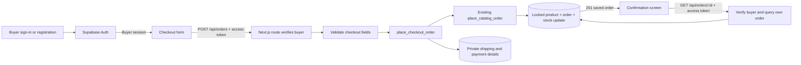

# Group 2 — Member 3: GC1 account checkout

## Scope

Review stack (do not merge out of order):
1. `g2/m3-order-backend` — #37, based on main.
2. `g2/m3-checkout` — #38, based on #37, supplies buyer Checkout.
3. `g2/m3-order-confirmation` — based on Checkout, supplies protected order reads and confirmation.

Related contract Issue #36 and existing Member 3 Issues #7/#8/#9. These PRs are current contributions, not evidence of past merge windows. Member 2's unmerged #29/#31 have overlapping UI responsibilities and need coordination.

Checkout follows GC1's buyer accounts, shipping address form and saved-order confirmation. GC2's checklist calls for simulated payment fields, so this slice does not process money or claim to hold funds in escrow. Guest checkout and its private-token mechanism were removed before any shared deployment.

New screens: `/checkout` and `/orders/:id`. A buyer can sign in or create an account from either screen. Supabase handles passwords and sessions; its existing new-user trigger creates the buyer profile. If email confirmation is enabled, the buyer must confirm their email before signing in. No secrets or passwords are stored in orders.

Each checkout orders one instrument, matching the existing order API. Other cart items remain in the cart. The server supports positive integer quantities and validates available stock.

Other members' cart, catalog/product screens, query logic, server actions, pricing logic and existing migrations are untouched. Checkout reuses the existing cart context and Supabase client.

## Team integration

- Member 2: link the cart to `/checkout`; optionally link Buy now to `/checkout?product=<product-id>` after adding that instrument. These links are not changed in this slice.
- Data owner: review/apply the new `*_account_checkout.sql` migration after existing migrations. It adds a private `order_checkout_details` table and service-only `place_checkout_order` wrapper. Existing orders and non-null buyer IDs are unchanged.
- Revenue integration is now included at the user's request: seller-paid 8% commission and optional physical inspection at ₱8,500 (price explicitly chosen by the user). Original inventory/pricing functions remain intact; an additive trigger snapshots the merchandise commission for new orders, and the checkout wrapper adds inspection only when selected. Member 4 should review the business rules.
- Member 5 can query the private `order_revenue` view through their server API for earned commission and completed inspection revenue. Buyer order totals are gross transaction amounts, not platform revenue.
- Existing Postman callers must now send a signed-in buyer access token to POST /api/orders. The route derives buyer_id from that token, ignoring any browser-supplied buyer identity.

## API

### POST /api/orders

Send `Authorization: Bearer <buyer Supabase access token>`.

```json
{
  "product_id": "<available product UUID>",
  "quantity": 1,
  "customer": {
    "full_name": "Test Buyer",
    "email": "test@example.com",
    "phone": "09123456789",
    "address": "123 Test Street, Manila"
  },
  "payment_method": "simulated_card",
  "inspection_requested": false,
  "payment_confirmed": true
}
```

`payment_method` accepts `simulated_card` or `simulated_gcash`. No real card fields are collected. Orders remain `pending`; no gateway or payout service is called. Browser totals are ignored.

- 201: saved order in `{ ok: true, data: { order } }`.
- 400: malformed JSON or invalid/missing customer, quantity or simulated payment fields.
- 401: missing/invalid buyer login.
- 403: buyer tries to purchase their own listing.
- 404: product/buyer profile not found.
- 409: unavailable product or insufficient stock.
- 500: save/configuration/database error.

Legacy authenticated requests without customer fields still use the existing order function; checkout requests save the shipping details as part of the same database transaction as the order/stock update.

### GET /api/orders/:id

Send the buyer's Supabase access token. The server verifies it with Supabase Auth and queries by both order ID and verified buyer ID.

- 200: saved order with server-calculated total.
- 401: missing/invalid session.
- 404: invalid ID, nonexistent order, or another buyer's order.
- 500: database/configuration failure.

Responses are `private, no-store`. Contact/address fields are not exposed by this confirmation endpoint.

## Architecture and request trace



Code flow: `src/components/buyer-account.tsx` → `src/components/checkout.tsx` → `app/api/orders/route.ts` → `src/lib/catalog/checkout-orders.ts` and `src/lib/validators/checkout-order.ts` → `place_checkout_order` → existing `place_catalog_order` → saved order and details → `src/components/order-confirmation.tsx` → `app/api/orders/[id]/route.ts` → saved total rendered.

The outer PostgreSQL function is one transaction: a shipping-details constraint failure rolls back both the saved order and the product update. The original function handles row locking and server pricing.

## Verification

- `npx tsx --test tests/*.test.ts`: input validation, server total handling, verified-buyer RPC argument, stock/error mapping, missing/invalid session rejection, and buyer-scoped retrieval.
- `tests/checkout.sql`: disposable PostgreSQL 17 with all migrations plus minimal Supabase Auth test stubs. Tests order save, buyer linkage, server amount, stock update, sold rejection, rollback on invalid payment details, private-table/RPC permissions, original order-function compatibility, and unchanged non-null buyer IDs.
- `tests/pricing.sql`: with/without inspection, exact seller deduction, rounding to centavos, buyer total, pending/earned revenue separation and permissions.
- Earlier configured local builds passed. Latest fresh PR-preparation build failed fetching the unchanged Google fonts from fonts.gstatic.com; the existing layout was not modified. TypeScript and ESLint for new/changed files pass. Browser automation connection also failed during the final signed-out recheck; no new browser success is claimed.
- Full-project lint has a pre-existing state-in-effect error in untouched `src/components/cart-context.tsx`.

Supabase sign-up, email confirmation, actual buyer sessions and the complete account-based browser flow still require verification on the real project. Earlier guest browser evidence does not certify this account-based flow.

## Setup and remaining deliverables

Use Node.js 20+, `npm ci`, and private `.env.local` values for `NEXT_PUBLIC_SUPABASE_URL`, `NEXT_PUBLIC_SUPABASE_ANON_KEY` and `SUPABASE_SERVICE_ROLE_KEY`. Never commit credentials. The browser uses only the public/anon key. Apply both reviewed new migrations in timestamp order, start with `npm run dev`, add a product through the existing storefront, and visit `/checkout` until Member 2 adds the link.

Still required: team contract review, actual Supabase migration/application testing, Member 4 review of the implemented rules, Member 2 navigation links, deployment, and Challenge 2 Network evidence plus the required hand-drawn trace. Local tests are not deployed evidence. Human PR review/merges and individual Challenge 5/recording remain the member's responsibilities.

Optional rate limiting and duplicate-request protection are not implemented. Submission is disabled while saving; a lost network response can still leave a saved order. Existing row locking prevents overselling.


## Revenue rules and change location

`checkout_pricing_rules()` in `*_order_revenue_breakdown.sql` is the single source for the 8% rate and ₱8,500 fee. `/api/checkout/pricing` supplies those rules to the checkout preview; the database independently computes the final amounts. UI values, totals and fees supplied by the browser do not set saved prices.

1. Commission is 8% of the guitar merchandise amount, rounded to two decimal places, and deducted from seller proceeds. It never increases the buyer's price.
2. Inspection is optional, defaults off, and costs ₱8,500 once per order. It is excluded from seller commission and seller proceeds.
3. New orders snapshot their rate and amounts. Later product-price or rule changes do not recalculate saved orders. Existing historical orders are not backfilled with invented charges.
4. Commission is earned only for orders in `approved` or `payout_released` status; pending simulated orders show zero earned commission in `order_revenue`.
5. Inspection is saved as `pending` when requested. The fee becomes earned/non-refundable when service is marked `completed`. No actual inspection, refund, payout, or payment processor workflow is implemented by this simulated checkout.
6. Buyer identity, quantity, stock and totals are validated server-side. Order creation, fee snapshot, details and stock updates occur in the same transaction.

Worked examples using seeded prices:

| Guitar amount | Inspection | Buyer total | Seller commission | Seller proceeds before other costs |
| --- | --- | --- | --- | --- |
| ₱485,000 | None | ₱485,000 | ₱38,800 | ₱446,200 |
| ₱485,000 | ₱8,500 | ₱493,500 | ₱38,800 | ₱446,200 |
| ₱168,000 | ₱8,500 | ₱176,500 | ₱13,440 | ₱154,560 |

Commission funds the marketplace and reduces seller proceeds without increasing the buyer's guitar price. The inspection adds gross service revenue and buyer cost; its actual margin depends on luthier costs, which have not been supplied. No inspection profit claim is made. Both features follow [GC1](https://docs.google.com/document/d/1cktgRo1WpGRbe9dgnjGLncR2xkySuHwsDNBVQ740xGM/edit).
